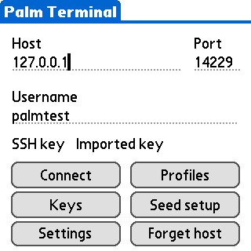
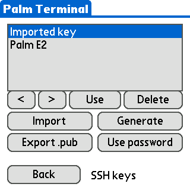
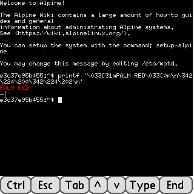
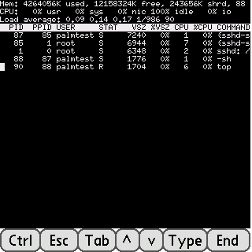
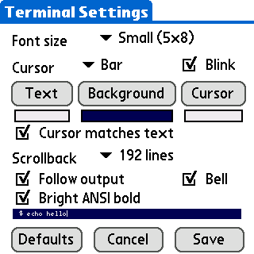

# Palm Terminal

Palm Terminal is an interactive SSH client for the Tungsten E2 and Palm OS 5. It supports a single shell over a configured Palm NetLib connection, saved connection profiles, password and Ed25519 authentication, and host-key verification.

## Screenshots

Captured on a Tungsten E2 in CloudpilotEmu using a local OpenSSH test server.

| Connection profile | SSH key manager |
| --- | --- |
|  |  |

| Color and UTF-8 in the shell | `top` running in the terminal |
| --- | --- |
|  |  |

## Install and connect

1. [Build the PRC](#build-and-test), then install `build/PalmTerminal.prc` with HotSync or from an SD card. Set up the Palm's network connection in Preferences.
2. On a trusted desktop, create a seed with `python3 tools/make_seed.py /path/to/SD/PALMTERM.SEED`. On the Palm, choose **Seed setup**, enter the SD path, and import the file. Remove the transferred file from the SD card and desktop after import. Provision each installation separately and import a fresh seed after restoring or cloning Palm state.
3. Enter the host, port, and username. Choose **Connect**. On first contact, compare the SHA-256 fingerprint shown on the Palm with the value obtained through a trusted route, such as `ssh-keygen -lf /etc/ssh/ssh_host_ed25519_key.pub` at the server console. Choose **Trust** if they match. The app reconnects with the saved host key and asks for the password or private-key passphrase. Use **Forget host** when you have independently established that a server's key has changed.
4. Use Graffiti or a keyboard to type in the shell. The five-way navigator sends arrows and Enter. **Ctrl** applies to the next key. **^** and **v** browse local scrollback. **Type** opens the Palm keyboard and a line entry field. **Send** submits the line and Enter. **End** closes the shell.

## SSH keys

- To import, copy an OpenSSH Ed25519 private key to SD. Use **Keys → Import**, enter its SD path and current passphrase, then name it and set the passphrase for the stored copy. A blank import passphrase accepts an unencrypted file. The importer supports the standard `bcrypt`/AES-256-CTR and `bcrypt`/AES-256-GCM forms with up to 128 bcrypt rounds.
- To create a key, use **Keys → Generate**, give it a name, and choose a passphrase. Select the key and use **Export .pub** to write its public key to SD. Add the line from that file to the intended account's `authorized_keys`.
- Select a key and tap **Use** to assign it to the current connection profile. **Use password** switches the profile to SSH password authentication.
- Passphrases are entered with Graffiti or a physical keyboard using printable ASCII. Stored private keys are protected with the OpenSSH AES-256-GCM key format. Keep the original desktop key if you need a backup of an imported identity. A generated identity belongs to this Palm installation.

## Terminal settings

Open **Settings** on the home screen or **Prefs** in an open shell. The preview shows the selected font, colors, and cursor. Settings apply to all connections. **Save** applies the changes to the current shell and saves them for later. **Defaults** restores the original choices in the preview.

- Choose a 5×8, 6×10, or 8×13 font. Changing the font updates the number of rows and columns sent to the server.
- Set default text and background colors. Applications can continue to show their own ANSI colors. Choose a block, underline, bar, or hidden cursor, with optional blinking and a custom cursor color.
- Choose up to 192 lines of scrollback or turn history off. **Follow output** returns to the live view when new text arrives while you're reading history. **Bell** enables the terminal beep, and **Bright ANSI bold** uses the bright palette for bold ANSI colors.



## Build and test

Install [Palm Toolchain](https://github.com/palmsnipe/palm-toolchain) with a user-supplied Palm OS 5 SDK. The default expects the toolchain checkout next to this project. Clang, Python 3, Node.js, and OpenSSH's `ssh-keygen` are used by the build or tests.

```sh
make PALM_TOOLCHAIN_ROOT=/path/to/palm-toolchain
make test PALM_TOOLCHAIN_ROOT=/path/to/palm-toolchain
```

`make test` validates the PRC and ARM resources and checks Ed25519 import, encryption, and generation against desktop OpenSSH. For an additional local test against a disposable OpenSSH test server, run either command with a synthetic test account. The test opens a PTY and transfers enough output to exercise rekeying when the test server uses `RekeyLimit 64K`.

```sh
build/host-test shell 14229 palmtest - terminal-test
build/host-test shell 14229 palmtest /path/to/test_id_ed25519 import-pass
```

See [Tungsten E2 verification](tests/E2.md) for the emulator setup, results, and measurements.

## Compatibility

The SSH transport uses `mlkem768x25519-sha256` or `curve25519-sha256`, AES-GCM, and Ed25519 or ECDSA P-256 server host keys. The shell advertises `TERM=xterm`. The bitmap fonts cover Latin text and line drawing, with replacement glyphs for other decoded characters. The ARM module runs wolfSSH with wolfCrypt and libvterm. The app uses the Palm OS APIs for forms, networking, and storage.

## Source and licenses

Palm Terminal is GPL-3.0-or-later. The ARM module contains wolfSSH and wolfCrypt under GPL-compatible terms. The reproducible source pins and checksums are in `tools/dependencies.py`. Keep the upstream sources and notices with redistributions. The `licenses` directory contains the MIT Palm Toolchain starter and libvterm notices, the OpenSSH-derived bcrypt and Blowfish notices, and the public-domain font notice. PalmTLS and PalmPass informed the Palm networking, ARM build, and seed provisioning approaches. The PRC contains its own SSH engine.
